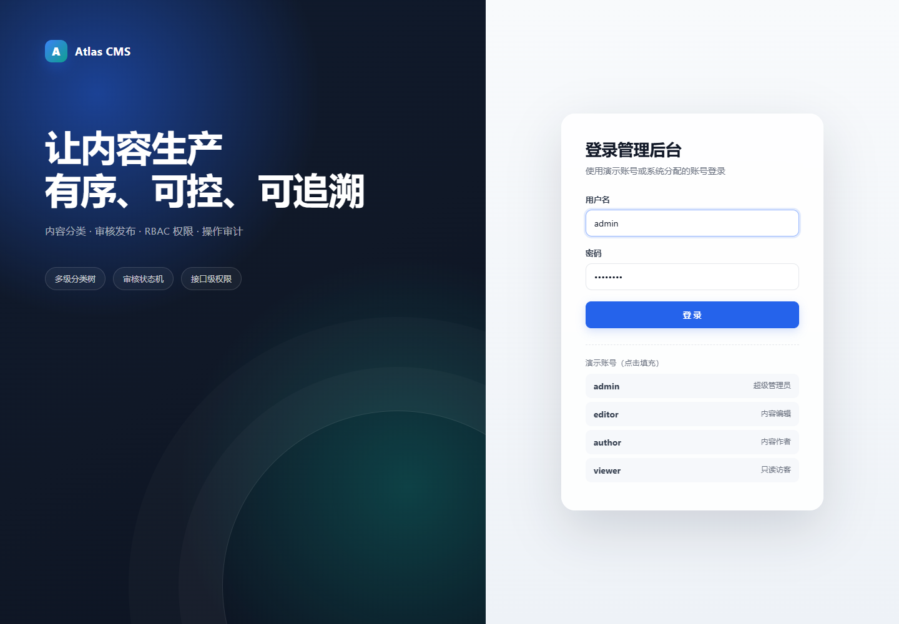
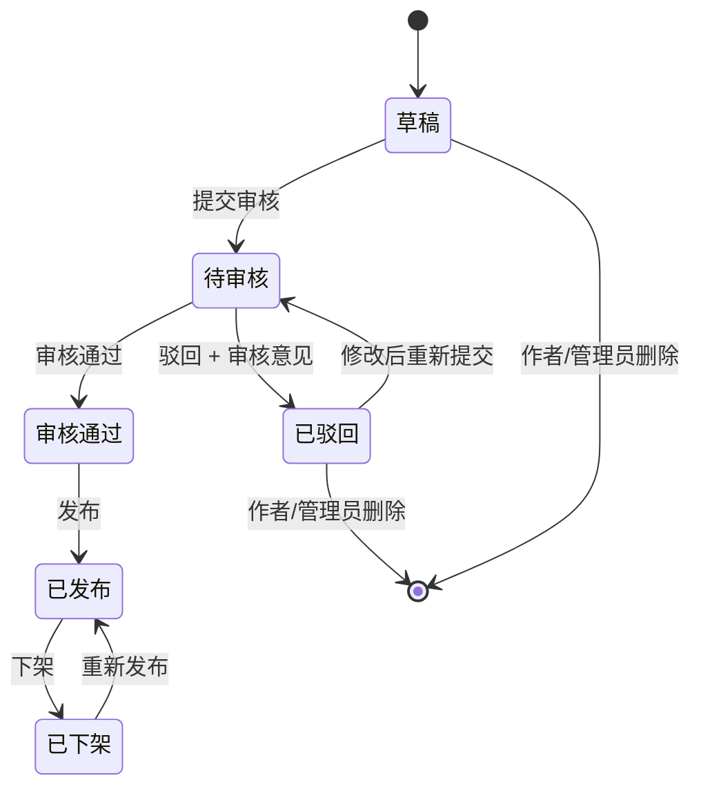

# Atlas CMS 内容管理系统

基于 **Spring Boot 2.7 / Spring 5.3 + SpringMVC + MyBatis-Plus + Druid** 的企业级 CMS 课程项目。系统覆盖文章创作、多级分类、审核状态机、用户与 RBAC 权限、高级检索、操作日志，并附带可直接操作的管理端页面、MySQL 脚本、自动化测试与课程交付文档。

> 零配置启动：默认使用 H2 内存数据库（MySQL 兼容模式），执行一条命令即可打开管理端；生产/验收场景切换到 **MySQL 9.5**（Connector/J 9.5.0）。



## 1. 功能清单

| 业务模块 | 实现内容 |
| --- | --- |
| 文章管理 | 新增、编辑、删除、分页列表、详情；草稿/待审核/通过/驳回/发布/下架完整状态机；批量发布、批量下架 |
| 内容审核 | 编辑审核通过或驳回；驳回必须填写审核意见；记录审核人、审核时间、审核意见 |
| 多级分类 | 递归分类树、父子级联、同级重名校验、移动防环、启停控制、删除引用保护 |
| 用户管理 | 用户分页检索、管理员创建、注册审批、启用/禁用、角色分配、重置密码、删除保护 |
| RBAC 权限 | 用户-角色-权限多对多；`@RequirePermission` + AOP 接口级拦截；ADMIN/EDITOR/AUTHOR/VIEWER 四类内置角色 |
| 高级检索 | 标题模糊、分类子树、状态、作者、起止日期、白名单排序、分页；JOIN 带出分类名/作者名，避免 N+1 |
| 操作日志 | `@Log` + AOP 记录操作人、模块、方法、URI、IP、耗时、成功/失败、脱敏参数；支持条件检索 |
| 统一响应 | `ResultVO { code, message, data, timestamp }`；HTTP 状态与业务码一致；全局异常处理不泄露堆栈 |
| 数据安全 | BCrypt 密码密文、Session 防固定、MyBatis 预编译参数、JSR-303 校验、密码字段日志脱敏 |
| MyBatis-Plus | 分页插件、Lambda 条件构造器、逻辑删除、自动填充、乐观锁、批量查询组装 |
| 管理端 | 原生 HTML/CSS/JS 单页管理台，按权限渲染菜单与操作，无需 Node 构建 |

## 2. 技术栈

| 层次 | 技术 |
| --- | --- |
| 运行环境 | JDK 17、Maven 3.8+ |
| Web | Spring Boot 2.7.18、Spring Framework 5.3.31、SpringMVC |
| 持久层 | MyBatis-Plus 3.5.7、MyBatis XML、Hikari 替代方案 Druid 1.2.23 |
| 数据库 | MySQL 9.5（生产/验收，Connector/J 9.5.0）、H2 2.x（默认零配置演示） |
| 校验 | Hibernate Validator / JSR-303（`javax.validation`） |
| 安全 | Session 登录、BCrypt（spring-security-crypto）、接口权限 AOP |
| 日志 | SLF4J + Logback；数据库操作日志 |
| 测试 | JUnit 5、Spring Boot Test、MockMvc、H2 |
| 前端 | 原生 HTML5 / CSS3 / JavaScript（无框架、无构建依赖） |

## 3. 快速开始

### 3.1 环境要求

- JDK **17**（`java -version` 确认）
- Maven 3.8+
- 无需安装数据库即可运行演示环境

### 3.2 H2 零配置启动（推荐演示）

```bash
# 在项目根目录执行
mvn clean package -DskipTests
java -jar target/cms.war
```

或者开发模式：

```bash
mvn spring-boot:run
```

启动后访问：

- 管理端：<http://localhost:8080/>
- 健康检查：<http://localhost:8080/api/health>
- H2 控制台：<http://localhost:8080/h2-console>
  - JDBC URL：`jdbc:h2:mem:cms`
  - 用户名：`sa`，密码：空
- Druid 监控：<http://localhost:8080/druid/>（仅本机，账号 `admin` / `admin123`）

H2 数据在进程重启后重置，适合课堂演示和自动化测试。

### 3.3 MySQL 9.5 启动

1. 初始化数据库：

```bash
# Windows 控制台需指定 utf8mb4，避免中文种子数据插入报 1366
mysql --default-character-set=utf8mb4 -uroot -p < sql/01_schema.sql
mysql --default-character-set=utf8mb4 -uroot -p < sql/02_data.sql
```

2. 使用 MySQL profile 启动：

```bash
java -jar target/cms.war --spring.profiles.active=mysql
```

或通过环境变量覆盖连接信息：

```bash
DB_HOST=localhost DB_PORT=3306 DB_NAME=cms_db \
DB_USERNAME=root DB_PASSWORD=你的密码 \
java -jar target/cms.war --spring.profiles.active=mysql
```

MySQL 9.5 脚本包含完整表结构、外键、索引和演示数据；`application-mysql.yml` 使用 Connector/J 9.5.0，并关闭了自动初始化，避免误覆盖生产数据。MySQL 9.5 默认认证插件为 `caching_sha2_password`，连接串已启用 `allowPublicKeyRetrieval=true`，本地演示可使用。

### 3.4 部署到外部 Tomcat 9（IDEA / 独立安装）

项目已打包为 **WAR**（`target/cms.war`），既可直接 `java -jar` 运行，也可部署到外部 Tomcat。

> **版本限制**：Spring Boot 2.7 基于 `javax.servlet`，只能部署到 **Tomcat 9.x**。
> Tomcat 10/11 使用 `jakarta.servlet`，启动时会因 `javax.servlet.*` 类缺失而失败；若要使用 Tomcat 10+，需要先迁移到 Spring Boot 3。

**方式一：手工部署**

1. 打包：`mvn clean package -DskipTests`
2. 把 `target/cms.war` 复制到 `%CATALINA_HOME%\webapps\`
3. 使用 **JDK 17** 启动 Tomcat 9
4. 访问 `http://localhost:8080/cms/`（context path 由 WAR 文件名决定；改名为 `ROOT.war` 即部署到根路径）

**方式二：IDEA 本地 Tomcat**

1. `Run/Debug Configurations` → `+` → `Tomcat Server` → `Local`
2. Application server 选择 **Tomcat 9.0.x**，JRE 选择 **17**（不要用 24）
3. `Deployment` 添加 `cms:war exploded`，`Application context` 建议填 `/cms`
4. 启动后访问 `http://localhost:8080/cms/`
5. MySQL 环境通过 Tomcat 进程环境变量注入：`SPRING_PROFILES_ACTIVE=mysql`、`DB_HOST/DB_PORT/DB_NAME/DB_USERNAME/DB_PASSWORD`

前端的静态资源使用相对路径，接口地址会根据当前 `context path` 自动拼接，因此部署在 `/cms`、`/mybatis_demo_cms_war_exploded` 或根路径都能正常登录与加载数据。更完整的排查步骤见 [docs/TOMCAT.md](docs/TOMCAT.md)。

## 4. 演示账号

| 账号 | 密码 | 角色 | 权限范围 |
| --- | --- | --- | --- |
| `admin` | `admin123` | 超级管理员 | 全部 13 个权限点，含用户、角色、日志 |
| `editor` | `editor123` | 内容编辑 | 文章全流程、分类管理 |
| `author` | `author123` | 内容作者 | 文章列表/新增/编辑/删除/提交、分类查看 |
| `viewer` | `viewer123` | 只读访客 | 文章与分类只读 |
| `pending` | `pending123` | 内容作者 | 待审批账号，登录返回 403 |

管理端登录页提供演示账号快捷填充。所有密码均以 BCrypt 密文存储，日志中的密码字段统一替换为 `******`。

## 5. 权限点与内置角色

| 权限码 | 说明 |
| --- | --- |
| `article:list` | 查看文章列表/详情 |
| `article:create` | 新增文章 |
| `article:edit` | 编辑自己的草稿/驳回文章（编辑、管理员可管理全部） |
| `article:delete` | 删除文章 |
| `article:submit` | 提交审核 |
| `article:audit` | 审核文章 |
| `article:publish` | 发布文章 |
| `article:offline` | 下架文章 |
| `category:list` | 查看分类树 |
| `category:manage` | 分类增删改、启停 |
| `user:manage` | 用户管理 |
| `role:manage` | 角色与权限管理 |
| `log:view` | 查看操作日志 |

权限码存放在数据库 `sys_permission`，通过 `sys_role_permission` 绑定角色；请求进入 Controller 时由 `PermissionAspect` 按当前会话权限实时校验。

## 6. 文章状态机



> 已驳回文章修改并保存后仍保持“已驳回”，只有再次提交审核才进入“待审核”。

核心规则由 `ArticleServiceImpl` 集中校验：

- 作者只能编辑、提交、删除**自己的草稿或已驳回文章**；
- 待审核文章不可直接修改，审核通过后不能回到草稿；
- 驳回必须填写审核意见；
- 发布仅允许“审核通过”或“已下架”状态；
- 更新使用 `version` 乐观锁，冲突返回 409，提示刷新重试。

## 7. 项目结构

```text
src/main/java/com/example/cms
├── annotation/          @RequirePermission、@Log
├── aspect/              权限拦截切面、操作日志切面
├── common/              ResultVO、PageVO、状态枚举、会话用户
├── config/              MyBatis-Plus、Druid、Jackson、WebMvc、BCrypt
├── controller/          RESTful Controller（8 个）
├── dto/                 请求对象 + JSR-303 校验
├── entity/              6 张业务表 + 2 张关联表实体
├── exception/           业务异常 + 全局异常处理
├── interceptor/         登录拦截器
├── mapper/              MyBatis-Plus Mapper + 自定义 XML 查询
├── service/             业务接口与实现
├── util/                安全、分页、IP 工具
└── vo/                  脱敏视图对象

src/main/resources
├── application*.yml      H2 / MySQL 环境配置
├── db/                  H2 建表与种子数据
├── mapper/              自定义 SQL XML
└── static/              管理端 HTML/CSS/JS

sql/                     MySQL 9.5 建库/初始化脚本
docs/                    API、架构、数据库、测试、报告提纲与 AI 使用声明
```

## 8. 关键实现说明

### 8.1 分层与统一响应

`Controller → Service → Mapper` 严格分层，Controller 只负责参数接收与统一返回，业务规则与事务边界在 Service。所有接口返回：

```json
{
  "code": 200,
  "message": "操作成功",
  "data": {},
  "timestamp": "2026-11-11 10:00:00"
}
```

业务异常由 `GlobalExceptionHandler` 转为对应 HTTP 状态和统一 JSON，未捕获异常返回 500 且不暴露堆栈。

### 8.2 MyBatis-Plus 特性

| 特性 | 使用位置 |
| --- | --- |
| 分页插件 | `MybatisPlusConfig`，文章/用户/日志分页 |
| Lambda 条件构造器 | 分类树、用户检索、日志检索等 |
| 逻辑删除 | `cms_article.deleted`、`cms_category.deleted`、用户/角色 |
| 自动填充 | `MyMetaObjectHandler` 填充创建/更新时间与操作人 |
| 乐观锁 | `cms_article.version` + `OptimisticLockerInnerInterceptor` |
| 自定义 SQL | 文章列表/详情 JOIN、用户批量角色查询、权限码查询 |
| 批量查询 | 用户分页后按 userIds 批量查角色，消除逐行查询 |

### 8.3 N+1 优化

文章列表使用 `cms_article LEFT JOIN cms_category LEFT JOIN sys_user`，一次分页查询同时返回 `categoryName`、`authorName`。用户列表先分页查询用户，再通过 `IN (userIds)` 一次查询全部角色关联并在内存分组，避免每行一次查询。排序字段使用固定白名单映射，不接受拼接 SQL。

### 8.4 安全与审计

- BCrypt 加密密码；登录成功后更换 Session，防止会话固定；
- 登录拦截器每次请求校验用户仍存在且状态正常；
- JSR-303 校验标题/正文/密码/角色编码等边界；
- MyBatis `#{}` 预编译参数，排序字段白名单，防 SQL 注入；
- AOP 权限拦截以数据库权限码为准，不在前端硬编码；
- `@Log` 记录关键写操作，`password/newPassword/oldPassword` 参数脱敏后落库；
- 全局异常处理不向前端输出堆栈信息。

## 9. 测试

```bash
# 请使用 JDK 17 运行测试
mvn test
```

测试使用 H2 + MockMvc，覆盖 22 个场景：登录/注册、401/403 权限拦截、文章状态机、驳回意见、乐观锁、SQL 注入载荷、批量操作、分类树/防环/删除保护、用户与角色管理、日志脱敏与筛选。详见 [docs/TESTING.md](docs/TESTING.md)。

浏览器端已通过 Playwright 冒烟验收：登录 → 新建草稿 → 提交审核 → 编辑审核 → 发布 → 详情 → 分类树 → 用户/角色/日志页面，且校验编辑角色看不到用户管理入口。同一套流程已在本机 MySQL 9.5.0（3306）服务上复验通过。

## 10. 文档索引

| 文档 | 内容 |
| --- | --- |
| [docs/ARCHITECTURE.md](docs/ARCHITECTURE.md) | 架构图、请求链路、AOP/RBAC、状态机、MyBatis-Plus 设计 |
| [docs/DATABASE.md](docs/DATABASE.md) | E-R 图、表结构、索引、外键、种子数据 |
| [docs/API.md](docs/API.md) | 接口说明、统一响应、错误码、权限矩阵、调用示例 |
| [docs/openapi.yaml](docs/openapi.yaml) | OpenAPI 3.0 规范，可导入 ApiFox / Swagger UI |
| [docs/TESTING.md](docs/TESTING.md) | 测试策略、22 个用例矩阵、浏览器验收记录 |
| [docs/TOMCAT.md](docs/TOMCAT.md) | 本地 Tomcat 9 部署、context path 适配与常见错误排查 |
| [docs/FINAL_REPORT_OUTLINE.md](docs/FINAL_REPORT_OUTLINE.md) | 课程设计报告提纲、评分点映射、图表清单 |
| [docs/AI_USAGE.md](docs/AI_USAGE.md) | AI 使用声明、交互记录、人工核验清单 |
| [docs/diagrams](docs/diagrams) | 架构图、E-R 图、文章状态机 draw.io 源文件 |
| [docs/screenshots](docs/screenshots) | 管理端运行截图 |

## 11. 常用接口

| 方法 | 路径 | 权限 |
| --- | --- | --- |
| POST | `/api/auth/login` | 公开 |
| POST | `/api/auth/register` | 公开（注册后待审批） |
| GET | `/api/auth/me` | 登录 |
| GET | `/api/articles` | `article:list` |
| POST | `/api/articles` | `article:create` |
| PUT | `/api/articles/{id}` | `article:edit` |
| DELETE | `/api/articles/{id}` | `article:delete` |
| POST | `/api/articles/{id}/submit` | `article:submit` |
| POST | `/api/articles/{id}/audit` | `article:audit` |
| POST | `/api/articles/{id}/publish` | `article:publish` |
| POST | `/api/articles/{id}/offline` | `article:offline` |
| GET | `/api/categories/tree` | `category:list` |
| POST/PUT/DELETE | `/api/categories/**` | `category:manage` |
| GET/POST/PUT/DELETE | `/api/users/**` | `user:manage` |
| GET/POST/PUT/DELETE | `/api/roles/**` | `role:manage` |
| GET | `/api/logs` | `log:view` |

完整参数与示例见 [docs/API.md](docs/API.md)。

## 12. 构建产物

```bash
mvn clean package
# 产物：target/cms.war（可执行 WAR，内含内嵌 Tomcat）
java -jar target/cms.war --spring.profiles.active=mysql
# 或部署到外部 Tomcat 9：
# copy target/cms.war %CATALINA_HOME%\webapps\，访问 http://localhost:8080/cms/
```

> `cms.war.original` 是不含 Spring Boot 启动器的原始 WAR，可忽略；`target/cms/` 是解包后的 exploded 目录，供 IDEA 热部署使用。

> 说明：自动化测试基于 JDK 17 + H2；另已在本机 **MySQL 9.5.0（3306）+ Connector/J 9.5.0** 服务上完成建表、初始化、应用启动、登录/文章接口验证和浏览器全流程冒烟，详见 [docs/TESTING.md](docs/TESTING.md) 1.5 节。连接实际 MySQL 时通过 `DB_PASSWORD` 注入密码，切勿将真实密码提交到版本库。
