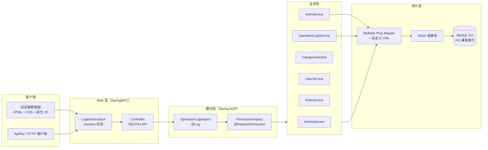
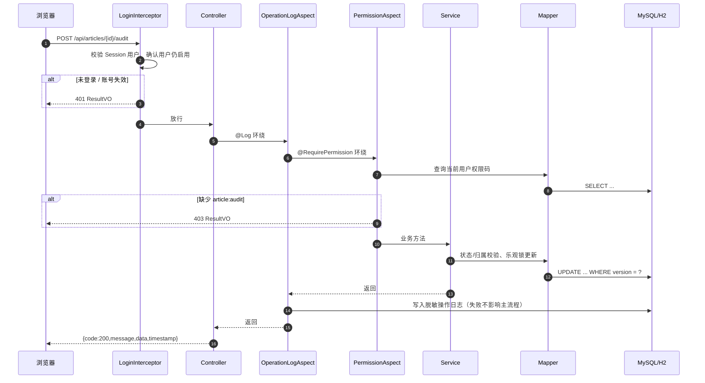
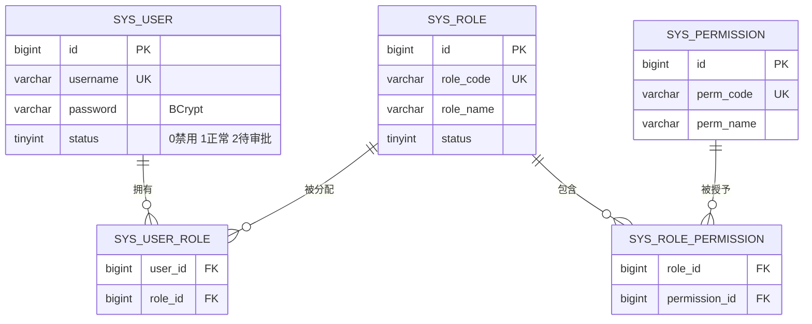
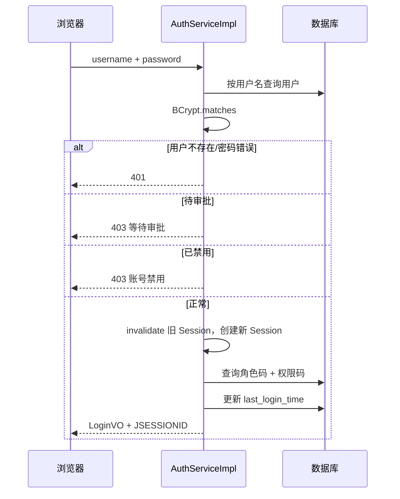
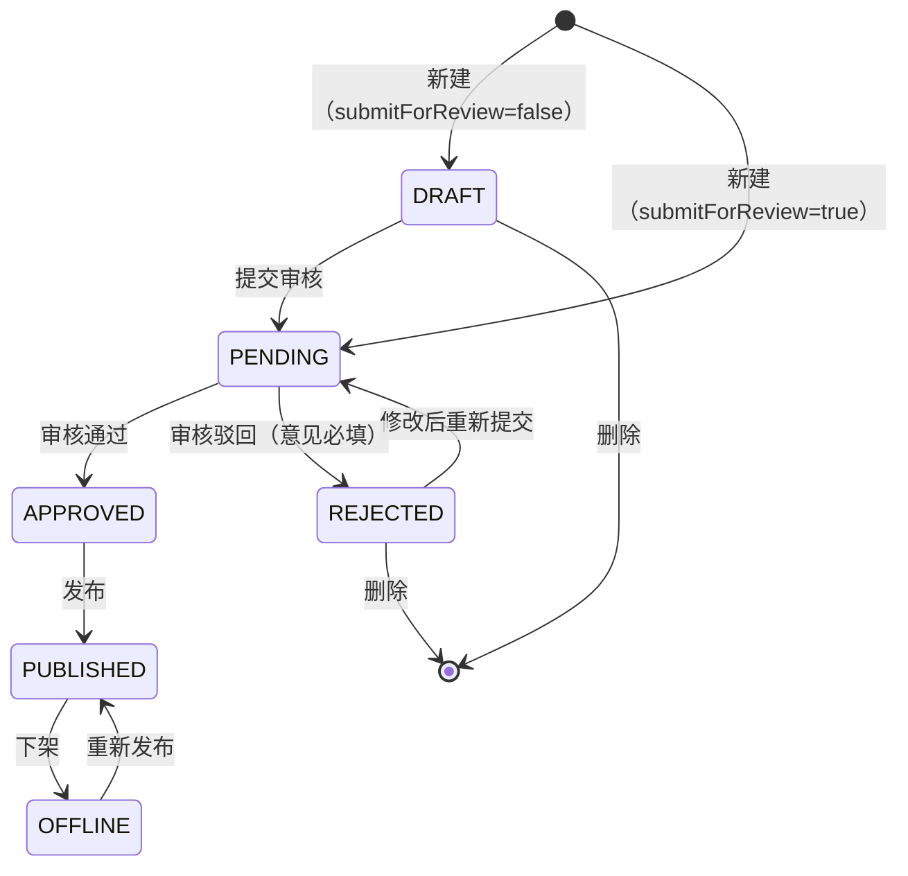
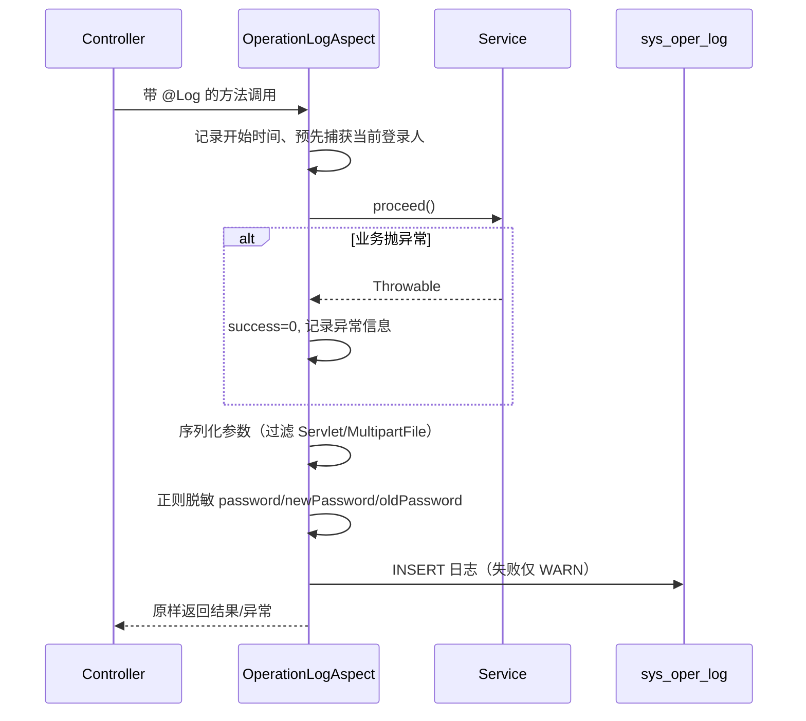

# 系统架构与关键设计

## 1. 总体架构



### 分层职责

| 层 | 职责 | 典型类 |
| --- | --- | --- |
| Controller | 路由、参数接收、`@Valid` 触发校验、统一 `ResultVO` 返回 | `ArticleController` |
| Aspect | 登录后权限校验、关键操作审计 | `PermissionAspect`、`OperationLogAspect` |
| Service | 业务规则、所有权判断、状态机、事务边界、N+1 组装 | `ArticleServiceImpl` |
| Mapper | 单表 CRUD、分页查询、JOIN/批量查询 | `CmsArticleMapper` |
| VO/DTO | 入参校验与出参脱敏，隔离数据库实体 | `ArticleCreateDTO`、`ArticleVO` |
| Config | MyBatis-Plus 插件、Jackson、密码编码器、MVC | `MybatisPlusConfig` |

### 为什么选择 Spring Boot 2.7 / Spring 5.3

项目任务书要求 Spring 5.x。Spring Boot 2.7.18 对应 Spring Framework 5.3.31，同时支持 Java 17、Jakarta 命名空间之前的 `javax.validation`，与 MyBatis-Plus 3.5.x、Druid 1.2.x 生态兼容稳定。项目没有使用 Spring 6 / Boot 3，避免偏离任务书的版本约束。

## 2. 请求处理链路



## 3. RBAC 与接口级权限

### 3.1 数据模型



### 3.2 权限校验切面

```java
@Around("@annotation(requirePermission)")
public Object check(ProceedingJoinPoint point, RequirePermission requirePermission) {
    LoginUser user = SecurityUtils.requireLoginUser();
    Set<String> codes = permissionMapper.selectPermissionCodesByUserId(user.getId());
    for (String required : requirePermission.value()) {
        if (!codes.contains(required)) {
            throw new PermissionDeniedException(required);
        }
    }
    return point.proceed();
}
```

设计要点：

- 权限判断以**数据库当前绑定关系**为准，管理员修改角色权限后无需重新登录即可生效；
- 多权限码采用“全部满足”语义；
- 切面在 Service 之前执行，越权请求不会触达业务和数据库写操作；
- 前端菜单只是体验层，真正安全边界在服务端。

### 3.3 登录与 Session



- Session 中仅保存 `LoginUser` 快照（id、username、nickname、roles、permissions）；
- 每次请求登录拦截器还会查询数据库确认用户未被删除/禁用；
- 密码使用 BCrypt cost 10，不可逆；
- 退出登录使 Session 失效。

## 4. 文章状态机



状态码：`0 草稿`、`1 待审核`、`2 审核通过`、`3 已驳回`、`4 已发布`、`5 已下架`。

| 操作 | 允许状态 | 额外约束 |
| --- | --- | --- |
| 编辑 | DRAFT / REJECTED | 作者本人或 EDITOR/ADMIN |
| 提交审核 | DRAFT / REJECTED | 作者本人或 EDITOR/ADMIN |
| 审核 | PENDING | `article:audit`；驳回备注必填 |
| 发布 | APPROVED / OFFLINE | `article:publish` |
| 下架 | PUBLISHED | `article:offline` |
| 删除 | 作者：DRAFT/REJECTED；管理者不限 | 作者仅能删自己的文章 |

所有状态变更以条件检查 + `version` 乐观锁完成，避免并发覆盖。

## 5. MyBatis-Plus 与数据访问设计

### 5.1 插件配置

```java
MybatisPlusInterceptor interceptor = new MybatisPlusInterceptor();
interceptor.addInnerInterceptor(new PaginationInnerInterceptor(DbType.MYSQL));
interceptor.addInnerInterceptor(new OptimisticLockerInnerInterceptor());
```

### 5.2 自动填充

`MyMetaObjectHandler` 在新增时填充 `createTime/updateTime/createBy/updateBy`，更新时强制覆盖 `updateTime/updateBy`。更新场景使用 `setFieldValByName` 而不是 `strictUpdateFill`，避免已加载实体上的非空字段阻止更新时间更新。

### 5.3 逻辑删除

`cms_article.deleted`、`cms_category.deleted`、`sys_user.deleted`、`sys_role.deleted` 标记逻辑删除。MyBatis-Plus 全局配置在查询与删除时自动追加条件，回收站/审计场景可保留历史数据。

### 5.4 N+1 优化

**文章列表/详情**：

```sql
SELECT a.id, a.title, ..., c.name AS category_name, u.nickname AS author_name
FROM cms_article a
LEFT JOIN cms_category c ON c.id = a.category_id
LEFT JOIN sys_user u ON u.id = a.author_id
WHERE a.deleted = 0 ...
ORDER BY a.create_time DESC
```

一条分页 SQL 同时获取分类名和作者名，避免列表每行再查两次。

**用户列表**：

1. 分页查询用户记录；
2. 收集 `userIds`，一次执行 `SELECT ... FROM sys_user_role ur JOIN sys_role r ... WHERE ur.user_id IN (...)`；
3. 按 userId 分组后装入 `UserVO.roles`。

用户数量固定为 pageSize（≤100），因此每页固定 2 条查询，与行数无关。

### 5.5 排序防注入

`ArticleQueryDTO` 用正则限制 `sortField ∈ {createTime,updateTime,publishTime,viewCount,title}`、`sortOrder ∈ {asc,desc}`；XML 再通过 `<choose>` 映射为固定列名，双重保障，绝不把用户输入直接拼接进 `ORDER BY`。

## 6. 事务、异常与校验

### 6.1 事务边界

- 写操作 Service 方法使用 `@Transactional(rollbackFor = Exception.class)`；
- 批量发布/下架在一个事务内先整体校验、再逐条更新，任一状态不合法则整批回滚；
- 分类移动/删除、用户角色重绑、角色权限重绑均在单事务内完成主表与关联表变更；
- 操作日志切面在业务事务之外执行且捕获异常，日志失败不影响主流程。

### 6.2 统一异常

| 异常 | HTTP / code | 处理 |
| --- | --- | --- |
| `UnauthorizedException` | 401 | 未登录/登录失效 |
| `PermissionDeniedException` | 403 | 缺少权限码/越权操作 |
| `NotFoundException` | 404 | 资源不存在 |
| `BusinessException(409, ...)` | 409 | 状态冲突、重名、乐观锁冲突 |
| 参数校验异常 | 400 | 拼接字段级中文提示 |
| `DataIntegrityViolationException` | 409 | 唯一键/外键冲突 |
| 其他异常 | 500 | 记录服务端日志，返回“系统内部错误” |

### 6.3 参数校验

- DTO 使用 `@NotBlank/@NotNull/@Size/@Pattern/@Min/@Max/@Email`；
- Controller 入参加 `@Valid`，类上 `@Validated` 支持方法级约束；
- 分页参数 `pageNum≥1`、`pageSize∈[1,100]`；
- 文章标题 2–100 字、正文 10–100000 字、审核意见 ≤500 字；
- 用户密码 8–32 位且同时包含字母和数字；
- 分类/角色编码使用正则限制，避免非法标识。

## 7. 操作日志设计



- `@Order(0)` 日志切面先于 `@Order(1)` 权限切面执行，因此越权请求同样可被审计；
- 登录接口在方法执行后才创建 Session，切面在 `finally` 中重新读取登录人，修复登录日志 `user_id` 为空的问题；
- 参数截断到 2000 字符，防止大字段撑爆日志表；
- 管理端提供日志条件检索和参数详情查看。

## 8. 部署与可观测性

- `target/cms.war` 为可执行 WAR（内嵌 Tomcat），支持 `--spring.profiles.active=mysql`，也可部署到外部 Tomcat 9；
- H2 环境使用内存库和自动初始化，适合演示/测试；
- Druid 提供连接池监控与 SQL 统计（`/druid/`，仅本机）；
- Spring Boot 健康端点 `/api/health` 可直接用于探活；
- 日志按 SLF4J + Logback 输出，业务日志写入 `sys_oper_log` 供审计查询。

## 9. 设计取舍与可扩展点

| 主题 | 当前实现 | 后续扩展 |
| --- | --- | --- |
| 认证 | Session + Cookie | 可替换 JWT / OAuth2，保持 `LoginUser` 抽象 |
| 缓存 | 权限码按请求查库 | 可加 Redis 缓存 + 角色变更失效 |
| 附件 | 纯文本正文 | 可接入对象存储与富文本编辑器 |
| 搜索 | MySQL LIKE + 条件过滤 | 可接 Elasticsearch 全文检索 |
| 审批 | 单级审核 | 可扩展审核链、会签、转审 |
| 日志 | 数据库表 | 可分表/异步队列写入，ELK 检索 |
