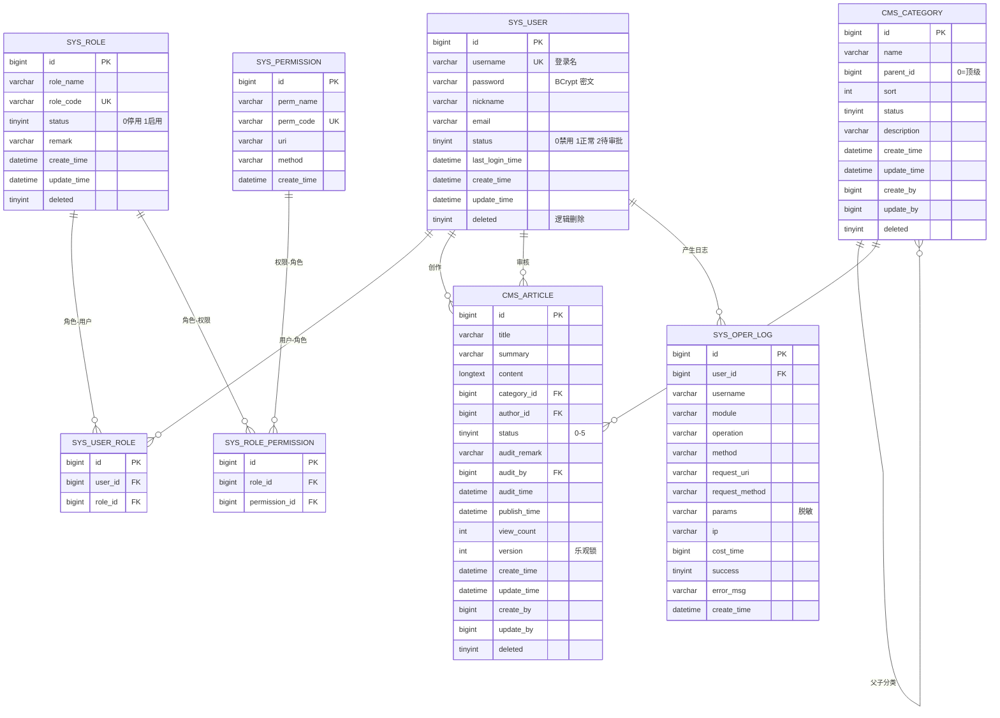

# 数据库设计说明

数据库设计以“用户—角色—权限”的 RBAC 结构与“分类—文章—审核/日志”的内容链路为核心，共 **6 张业务表 + 2 张关联表**。MySQL 9.5 脚本位于 [`sql/01_schema.sql`](../sql/01_schema.sql)、[`sql/02_data.sql`](../sql/02_data.sql)；H2 演示脚本位于 `src/main/resources/db/`。

## 1. E-R 图



## 2. 表清单

| # | 表名 | 说明 | 主要关系 |
| --- | --- | --- | --- |
| 1 | `sys_user` | 系统用户，含登录名、BCrypt 密码、状态、最后登录时间 | 与角色多对多 |
| 2 | `sys_role` | 角色，含唯一角色编码与启停状态 | 与用户、权限多对多 |
| 3 | `sys_permission` | 权限点，权限码用于 AOP 接口校验 | 与角色多对多 |
| 4 | `sys_user_role` | 用户-角色关联，唯一键 `(user_id, role_id)` | 多对多中间表 |
| 5 | `sys_role_permission` | 角色-权限关联，唯一键 `(role_id, permission_id)` | 多对多中间表 |
| 6 | `cms_category` | 多级内容分类，`parent_id=0` 为顶级 | 自关联 + 一对多文章 |
| 7 | `cms_article` | 文章主体、状态、审核元数据、发布时间、乐观锁版本 | 归属分类/作者/审核人 |
| 8 | `sys_oper_log` | 操作审计日志，记录脱敏参数与耗时 | 归属操作人（可为空） |

## 3. 关键字段与约束

### 3.1 用户表 `sys_user`

| 字段 | 类型 | 约束 | 说明 |
| --- | --- | --- | --- |
| `id` | BIGINT | PK, AUTO_INCREMENT | 主键 |
| `username` | VARCHAR(50) | NOT NULL, UNIQUE | 登录名，4–32 位字母/数字/下划线（业务校验） |
| `password` | VARCHAR(100) | NOT NULL | BCrypt 密文，不存明文 |
| `nickname` | VARCHAR(50) | NOT NULL | 展示名称 |
| `email` | VARCHAR(100) | NULL | 邮箱 |
| `status` | TINYINT | NOT NULL, DEFAULT 1 | 0 禁用 / 1 正常 / 2 待审批 |
| `last_login_time` | DATETIME | NULL | 最后登录时间 |
| `deleted` | TINYINT | NOT NULL, DEFAULT 0 | 逻辑删除 |

索引：`uk_user_username(username)`、`idx_user_status(status)`。

### 3.2 角色与权限

- `sys_role.role_code` 唯一，内置 `ADMIN/EDITOR/AUTHOR/VIEWER`；ADMIN 角色编码不可修改、角色不可删除。
- `sys_permission.perm_code` 唯一，采用 `模块:动作` 命名，如 `article:audit`。
- 两张关联表均设复合唯一键，防止重复绑定；外键使用 `ON DELETE CASCADE`，物理删除角色时清理关联。
- 角色仍绑定用户时业务层拒绝删除，避免误伤。

### 3.3 分类表 `cms_category`

- `parent_id = 0` 表示顶级；父子关系在同一张表内自关联；
- 同级分类名唯一由业务层校验（`parent_id + name`），避免数据库大小写/排序规则差异影响提示；
- `sort` 升序决定同级展示顺序；
- 移动分类时检查“不能移动到自己或子孙节点下”，防止环；
- 删除前校验子分类与文章引用；
- `status` 为 0 的分类不可挂载新文章，但历史文章保留可查。

### 3.4 文章表 `cms_article`

| 字段 | 说明 |
| --- | --- |
| `status` | 0 草稿 / 1 待审核 / 2 审核通过 / 3 已驳回 / 4 已发布 / 5 已下架 |
| `audit_remark` | 审核意见，驳回时业务层强制非空 |
| `audit_by` / `audit_time` | 审核人与审核时间 |
| `publish_time` | 首次/最近发布时间 |
| `version` | MyBatis-Plus `@Version` 乐观锁版本 |
| `deleted` | 逻辑删除，历史数据保留 |

索引设计：

- `idx_article_category_status(category_id, status)`：分类+状态筛选；
- `idx_article_publish_time(publish_time)`：发布时间排序/范围；
- `idx_article_author(author_id)`：作者维度；
- `idx_article_title(title(50))`：标题模糊检索前缀索引（实际 LIKE 全模糊仍会扫描，生产可引入全文索引/搜索引擎）。

外键：`category_id → cms_category(id)`、`author_id → sys_user(id)`。采用默认 RESTRICT，配合业务层校验，避免误删被引用的分类/用户。

### 3.5 操作日志表 `sys_oper_log`

- `params` 存储序列化后的参数，长度 2000，密码字段已脱敏为 `******`；
- `success` 为 1/0，失败时记录 `error_msg`（截断 1000）；
- 索引 `idx_log_user_time(user_id, create_time)`、`idx_log_create_time(create_time)` 支持按人/时间检索；
- 用户外键 `ON DELETE SET NULL`，即使用户被物理删除也保留审计痕迹；当前用户采用逻辑删除，历史日志仍保留用户名快照。

## 4. 数据字典与状态枚举

| 枚举 | 值 |
| --- | --- |
| 用户状态 `UserStatus` | 0 禁用、1 正常、2 待审批 |
| 通用启停 `EnableStatus` | 0 停用、1 启用 |
| 文章状态 `ArticleStatus` | 0 草稿、1 待审核、2 审核通过、3 已驳回、4 已发布、5 已下架 |
| 日志结果 | 0 失败、1 成功 |

## 5. 种子数据

### 5.1 演示账号

| 用户名 | 明文密码 | 角色 | 用途 |
| --- | --- | --- | --- |
| `admin` | `admin123` | ADMIN | 全功能演示 |
| `editor` | `editor123` | EDITOR | 审核/发布演示 |
| `author` | `author123` | AUTHOR | 作者流程演示 |
| `viewer` | `viewer123` | VIEWER | 只读权限演示 |
| `pending` | `pending123` | AUTHOR | 待审批登录拦截演示 |

> 数据库中只保存 BCrypt 密文；上表明文仅用于课程演示。

### 5.2 分类

- 技术资讯（1）→ 前端开发（3）、后端开发（4）、人工智能（5）
- 产品动态（2）→ 公司新闻（6）
- 历史归档（7，停用）

### 5.3 文章与日志

6 篇种子文章覆盖草稿、待审核、审核通过、已驳回、已发布、已下架全部状态，其中一篇挂在停用分类下，用于演示“停用分类不可新增”的边界。4 条种子日志覆盖成功/失败、登录/审核/提交/删除等场景。

## 6. 初始化方式

### MySQL 9.5

```bash
mysql -uroot -p < sql/01_schema.sql
mysql -uroot -p < sql/02_data.sql
```

### H2（自动）

`application-h2.yml` 在启动时执行：

- `classpath:db/schema-h2.sql`
- `classpath:db/data-h2.sql`

每次进程启动重建内存数据库，保证演示数据可重复。

## 7. 设计说明与注意点

1. **逻辑删除与唯一键**：用户名、角色编码采用物理唯一键 + 逻辑删除。若未来允许“删除后重新注册同名账号”，需改为部分唯一索引或带删除标记的复合唯一键。
2. **分类同级重名校验**：在 Service 层完成而非仅靠数据库唯一键，可给出明确中文提示并兼容 H2/MySQL 排序规则差异。
3. **状态与权限双边界**：权限 AOP 解决“能不能调用”，Service 状态机解决“当前状态能不能做”，两层不能互相替代。
4. **审计与隐私**：日志只保存脱敏参数；错误信息截断，避免大字段/敏感数据入库。
5. **时区**：MySQL 连接串使用 `serverTimezone=Asia/Shanghai`，Jackson 统一 GMT+8，前端显示 `yyyy-MM-dd HH:mm:ss`。
6. **字符集**：MySQL 建库使用 `utf8mb4/utf8mb4_unicode_ci`，支持中文和 emoji。
